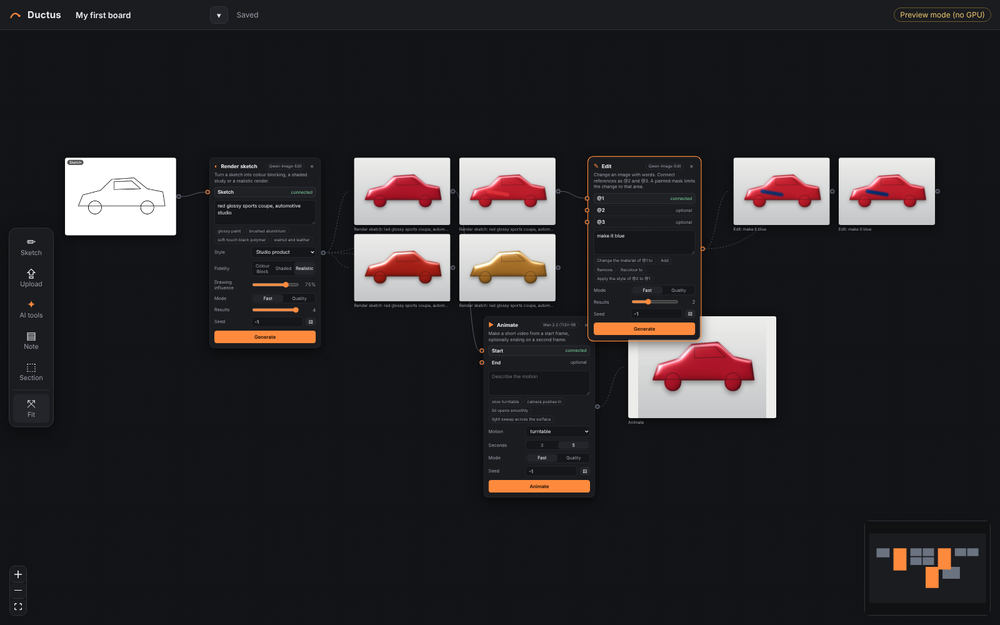

# Ductus

An AI design studio for product, industrial and transportation designers, built only on **open-weight models** you can run yourself.

Sketch, generate, edit and animate on an **infinite canvas**. Images connect to AI tool blocks, results land beside the block, and the history of every design stays visible as a graph.



> Status: phase 1 (canvas + image tools + first video tool). Runs fully in **preview mode** without a GPU; connect a ComfyUI server to use the real models.

> **Windows laptop with an NVIDIA GPU (8 GB+)?** Double-click `Install-GRAPAI.cmd`: it installs everything for your user account, with no admin rights. See [docs/windows-install.md](docs/windows-install.md).

## Features

| Tool | What it does | Default open model | Licence |
|---|---|---|---|
| **Create** | Images from a description, with style presets and aspect ratios | Z-Image-Turbo (fast), Qwen-Image-2512 (quality) | Apache-2.0 |
| **Render sketch** | Sketch → colour blocking, shaded study or realistic render, with a drawing-influence control | Qwen-Image-Edit-2511 | Apache-2.0 |
| **Edit** | Change an image with words. Connect up to two references and refer to them as `@2`, `@3`. Paint a mask to edit only that region | Qwen-Image-Edit-2511 (+ 4-step Lightning LoRA in fast mode) | Apache-2.0 |
| **New view** | Rotate the design in 45° steps, choose camera height | Qwen-Image-Edit-2511 | Apache-2.0 |
| **Animate** | Start frame (+ optional end frame) → short video; turntable, push-in, reveal, orbit or your own prompt | Wan 2.2 TI2V-5B (fast), Wan 2.2 I2V-A14B with first/last frame (quality) | Apache-2.0 |
| **Remove background** | Clean product cut-outs | BiRefNet | MIT |
| **Upscale** | 2× / 4× for presentation | Real-ESRGAN x4plus | BSD-3-Clause |

The board (infinite canvas):

- Pan, zoom, minimap, box select, fit (`Shift+1`) and fit selection (`Shift+2`).
- Items: images, videos, sketches, sticky notes (`N`), sections (`S`) that carry their contents when moved.
- Drop or paste images and MP4s anywhere. Results stay linked to the block that made them.
- Double-click an image to open the editor: layers with opacity and blend modes, pen-pressure brush, eraser, mask brush and lasso. A painted mask limits **Edit** to that area.
- Video items: play, scrub, **Save frame** to start the next shot from any frame.
- Boards autosave on the server.

## Quick start (preview mode, no GPU)

Requires Python 3.10+ and Node 20+.

```bash
# API
cd backend
python -m venv .venv && . .venv/bin/activate
pip install -e ".[dev]"
uvicorn ductus.api:app --reload --port 8000

# Web app (second terminal)
cd frontend
npm install
npm run dev        # http://localhost:5173
```

Preview mode uses procedural CPU stand-ins for every tool (they are not AI). They exist so the whole app can be developed and tested anywhere; the badge in the top bar shows when it is active.

Or with Docker: `docker compose up --build` and open http://localhost:8000.

## Using the real models

The AI tools run on a [ComfyUI](https://github.com/comfyanonymous/ComfyUI) server reached over its HTTP API. ComfyUI already supports every model above with quantised weights, so one 24 GB GPU covers all image tools and the fast video model.

```bash
DUCTUS_PROVIDER=comfy DUCTUS_COMFY_URL=http://<gpu-host>:8188 uvicorn ductus.api:app --port 8000
pip install -e ".[local]"   # BiRefNet + Real-ESRGAN run in-process (CPU works)
```

See [docs/comfyui.md](docs/comfyui.md) for the model files and GPU sizing, and [docs/hybrid-setup.md](docs/hybrid-setup.md) to run fast mode on an 8 GB laptop and quality mode plus video on a rented GPU. Each tool's graph lives in `backend/comfy_workflows/` and can be replaced by your own ComfyUI workflow.

Per-tool overrides are possible, for example `DUCTUS_PROVIDER_ANIMATE=mock`.

## Project layout

```
backend/
  ductus/api.py            FastAPI: assets, jobs, boards
  ductus/workflows.py      tool catalogue (drives the UI), style presets
  ductus/jobs.py           job queue
  ductus/providers/        mock (CPU), comfy (ComfyUI), local (torch) backends
  comfy_workflows/         ComfyUI API graphs with {{placeholders}}
  tests/
frontend/
  src/board/               infinite canvas (React Flow), nodes, tool blocks
  src/editor/              layered raster editor with masks
```

## Tests

```bash
cd backend && pytest          # API, every tool in preview mode, ComfyUI templating
cd frontend && npm run build  # type check + production build
```

## Roadmap

1. ✅ Board, Create, Render sketch, Edit (refs + mask), New view, Remove background, Upscale, Animate (start/end frame)
2. Video: turntable from several views, replace subject (Wan-Animate), video upscaling (SeedVR2), MP4/GIF export settings
3. Variations (form pad, colourways), extend/outpaint, style dropper, live render while drawing (Z-Image-Turbo + ControlNet)
4. Accounts, sharing, comments; 3D (TRELLIS.2, MIT)

## Licence

Ductus is Apache-2.0. Each model has its own licence (see the table); all defaults allow commercial use worldwide. ComfyUI is GPL-3.0 and runs as a separate service.
